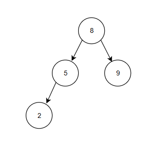
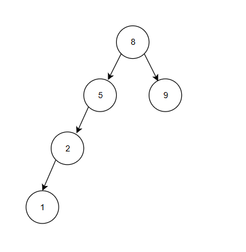
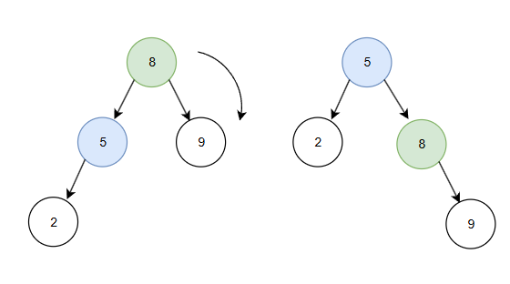
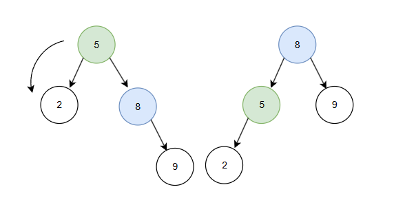
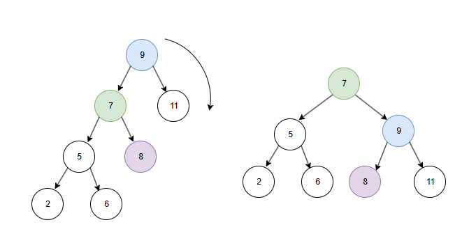
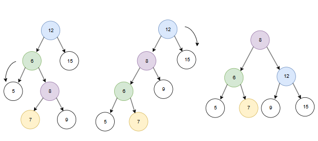

前情提要：[二叉搜索树](二叉搜索树.md)

前面提到了二叉搜索树这种结构，但是在实际使用中，二叉搜索树很容易退化成链表形态，比如：
```
欲插入：1，2，3
实际的树：
     1
      \
       2
        \
         3
```
这样的结构会使得二叉搜索树的查找效率退化，因此，我们需要用一些方法来保证二叉搜索树的结构是稳定的，这个时候就需要用到AVL树了

### 平衡因子
如何定义一个树是稳定，或者说**平衡**的呢；在这里，我们介绍平衡因子（Balance Factor）的概念

对于某一个节点的平衡因子，其计算方式是这样的：
$$
BF(node) = height(node.left) - height(node.right)
$$
通俗地说，就是当前节点的左子树高度减去右子树高度

当这个值超过 1 的时候，意味着整个树陷入了一种不平衡的状态：

*较为平衡的树*

*不平衡的树，对于此时的平衡因子已经大于1了（对于节点8来说）*

因此，思路也很清晰了，每当我们进行一次改变树结构的操作时（比如插入，删除），就计算整个树的平衡因子，当平衡因子大于1的时候，就进行平衡修正操作

此时，我们就需要介绍另一个概念：**树的旋转**

### 树的旋转
给出一个节点，让其向某个方向旋转就是将其挂到对应方向的子树下面：

左旋：

对应代码：
```cpp
Node<T>* LRotate(Node<T>* target) {
     Node<T>* x = target->right;
     Node<T>* y = x->left;

     x->left = target;
     target->right = y;

     updateHeight(target);
     updateHeight(x);

     return x;
}
```

右旋：

对应代码：
```cpp
Node<T>* RRotate(Node<T>* target) {
     Node<T>* x = target->left;
     Node<T>* y = x->right;

     x->right = target;
     target->left = y;

     updateHeight(target);
     updateHeight(x);

     return x;
}
```

如上面两张图所示

而当一个AVL树不平衡了，让其恢复平衡的过程中，最重要的就是确定每一个节点的平衡因子，让他们的绝对值不超过1即可

其中，最常见的有下面四种不平衡方式：
#### LL型
其本质是：根结点的平衡因子 = 2，左子树根结点平衡因子 = 1 所导致的不平衡：


#### LR型
其本质是：根结点的平衡因子 = 2，左子树根结点平衡因子 = -1 所导致的不平衡：


最后两种便是 RR 型和 RL 型，其图像与上面两图是对称关系的，而其平衡因子关系：

- RR：根结点的平衡因子 = -2，左子树根结点平衡因子 = -1
- RL：根结点的平衡因子 = -2，左子树根结点平衡因子 = 1

当然，**需要注意的是**，AVL树的非平衡情况不止这么几种，判断平衡情况的关键因素还是要看平衡因子，并根据平衡因子进行正确的旋转，那么，我们就可以写出如下代码：
```cpp
Node<T>* balance(Node<T>* node = nullptr) {
     if (!node) node = root;
     if (!root) return;

     updateHeight(node);
     int bf = getBF(node);

     if (bf > 1) {
          if (getBF(node->left) <= 0) {
               node->left = LRotate(node->left);
          }
          return RRotate(node);
     }
     if (bf < -1) {
          if (getBF(node->right) >= 0) {
               node->right = RRotate(node->right);
          }
          return LRotate(node);
     }

     return node;
}
```
> [!NOTE]
> **为什么需要返回值？** 
> 我们需要在平衡过程中确定每一次旋转的节点是什么，而根据前面的实现，每一次的旋转后会返回旋转后的新根节点；有了这个，我们就可以很方便的进行后面的操作

以上便是AVL树的关键部分

至于其增删查改的部分，与二叉搜索树不同的是，每一次的插入和删除后需要重新更新每个节点的高度，并进行平衡处理；以防结构特征不符合AVL树的性质
