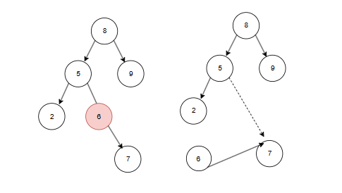

二叉树在查找方面有重要应用，因此我们有二叉搜索树这种较为高效的查找结构

简单概括，二叉搜索树满足下面的特性：

**对于任意一个节点，其左孩子的值必定比本节点的值要小；右孩子的值必定比本节点的值大**

在节点设计上，和二叉树是一样的：
```C++
template<typename T>
struct Node {
    T value;
    Node* left = nullptr;
    Node* right = nullptr;
};
```

为了方便维护这样一个二叉搜索树，我们需要一个专门的类来进行，我们给他命名为 `BSTree`

接下来，我们需要实现这个二叉搜索树的各种操作了

## 插入
插入节点，我们唯一需要记住的点就是二叉搜索树自己的性质：**对于任意一个节点，其左孩子的值必定比本节点的值要小；右孩子的值必定比本节点的值大**

因此，我们可以写出下面的代码：
```C++
void insert(T val, Node<T>* cur) {
    if (val >= cur->value) {
        if (cur->right) {
            insert(val, cur->right);
        }
        else {
            cur->right = new Node<T>;
            cur->right->value = val;
        }
    }
    else if (val < cur->value) {
        if (cur->left) {
            insert(val, cur->left);
        }
        else {
            cur->left = new Node<T>;
            cur->left->value = val;
        }
    }
}
```
上面的实现使用了递归的方法，当进入对应的分支后，如果当前指针指向的节点的对应左分支/右分支是存在的话，那么就会继续进行插入操作

否则，直接创建新的节点在对应节点的左分支/右分支上

## 查找
查找的核心就是确定目标元素是否在树内，查找的时候需要注意：目标元素必须有**可比较**的特性，否则不方便进行查找

下面是具体代码：
```C++
bool contains(T val, Node<T>* cur) {
    if (cur->value == val) return true;

    if (val >= cur->value) {
        if (cur->right) return contains(val, cur->right);
        return false;
    }

    if (cur->left) return contains(val, cur->left);
    return false;
}
```
和插入方法一样，也使用递归的方式进行

## 删除
删除是最麻烦的一个功能，它需要考虑到各种情况：
#### 删除叶子节点
这种情况最简单，直接删除即可
#### 删除只有一个孩子的节点
对于这种节点，将其孩子替换到原来的位置即可：

#### 删除有两个孩子的节点
这种情况是最麻烦的，不能随意替换，否则会导致整个树不符合其性质

这个时候，用中序后继替换就是最稳妥的方法
> [!NOTE]
> 对于一个确定的节点，其中序后继就是该节点右子树的最小值（最左端）

由于中序后继的特性，可以保证替换之后，整个二叉搜索树的性质是不变的

因此，我们可以写出下列代码：
```C++
void remove(T target) {
    if (!root) return;

    Node<T>* cur = root;
    Node<T>* parent = nullptr;

    // 用于定位到要删除的节点的位置
    while (cur != nullptr) {
        if (cur->value == target) break;
        parent = cur;
        if (target < cur->value)
            cur = cur->left;
        else
            cur = cur->right;
    }

    // 如果 cur == nullptr，说明不存在这个节点，函数直接返回
    //当然，更科学的做法是进行报错
    if (!cur) return;

    // 第一种和第二种情况的合并，当节点不是两个节点同时存在的情况
    if (!cur->left || !cur->right) {
        Node<T>* child = cur->left ?cur->left : cur->right;
        // 进行根节点判断，不然会破坏整个树
        if (cur != root) {
            if (parent->left == cur) {
                parent->left = child;
            }
            else parent->right = child;
        }
        else {
            root = child;
        }
        delete cur;
    }
    else {
        // 寻找中序后继
        Node<T>* node = cur->right;
        while (node->left) {
            node = node->left;
        }
        // 此时的这个tmp就是中序后继，进行寄存
        T tmp = node->value;
        // 删除这个中序后继节点，并将当前节点的值替换为寄存的值
        remove(tmp);
        cur->value = tmp;
    }
}
```