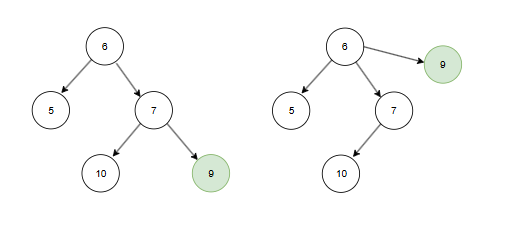

并查集是一种集合，可以管理其下元素的所属等特征；其本质是一个森林

对于并查集，最基本的就是实现下面几种操作：合并和查询

我们可以创建下面这种最基本的并查集类来进行实现
```cpp
template<long long N>
class DSU {
    long long size;
    long long parent[N];
public:
    DSU() {
        for (long long i = 0; i < N; i ++) {
            parent[i] = i;
        }
    }
}
```
在上面的初始化实现中，我们是将所有的元素都看成了一个单独的节点；同时以约定根节点的父亲就是自己

接下来，我们就需要实现合并和查询这两种操作：
### 查询
查询操作，就是查询当前所给元素是属于哪个集合的，返回的自然也就是这个集合的根节点
```cpp
long long belong(long long target) {
    if (target < 0 || target >= N) {
        throw std::out_of_range("DSU element out of range");
    }

    if (target == parent[target]) return target;
        
    return belong(parent[target]);
}
```
对于上面的实现，当给定的目标值和自己的父亲是一个值，说明自己就是根节点，直接返回自己即可；

而如果不是，则进行递归，直到找到自己所属的集合为止

至于方法开头所给的判断功能，这个是为了防止用户给出超出并查集范围的数值进行查询

当然，如果查询使用这种实现，当我们遇到了一个复杂的集合，就要重复地进行递归的操作，这个时候我们就需要用到一些优化方法，比如路径压缩：

路径压缩的根本原理就是当查询到当前元素的所属集合后，直接将当前元素的父亲指定为根节点，这样可以省去中间递归的次数，极大地提升效率，而具体到代码上，就是这样的：
```cpp
long long belong(long long target) {
    if (target < 0 || target >= N) {
        throw std::out_of_range("DSU element out of range");
    }

    if (target == parent[target]) return target;
        
    return parent[target] = belong(parent[target]);
}
```
值得注意的是，末尾的返回处不同了，我们写成了：`parent[target] = belong(parent[target]);`，这个就是对路径压缩的具体实现
### 合并
合并操作较为简单，我们只需要找到一方的根节点，然后令其根节点的父亲为另一个要合并的节点即可：
```cpp
void merge(long long A, long long B) {
    if (target < 0 || target >= N) {
        throw std::out_of_range("DSU element out of range");
    }

    parent[belong(A)] = belong(B);
}
```