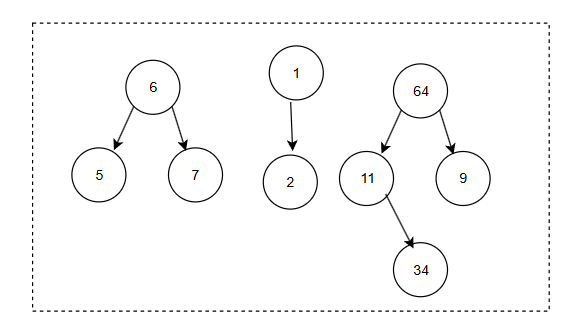
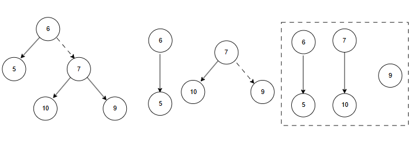

前面已经讲过树的[简单概念](../算法/树-基础.md)，现在简单介绍一下森林的概念：

森林，就是若干个互不相交的树的集合：

那么如何将二者相互转化呢

## 树 $\rightarrow$ 森林
其实，二者的转化非常简单

对于树来说，能否转化为森林主要看这个树是否有**右孩子**，如果有，则可以转化为森林，否则仍然是树

方法是：从根节点开始，若右孩子存在，则把与右孩子结点的连线删除；再查看分离后的二叉树，若其根节点的右孩子存在，则连续删除；直到所有这些根结点与右孩子的连线都删除为止

## 森林 $\rightarrow$ 树
与树到森林的转化相反，从森林到树只需要依次将右孩子相连即可
