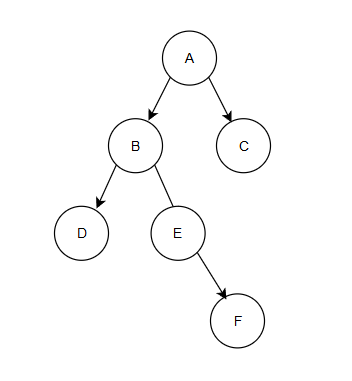

介绍线索二叉树之前，需要先介绍一下关于二叉树的前驱和后继概念

## 二叉树的前驱和后继
我们都知道，在链表中，一个节点的前驱是其前面的一个节点，后继就是其后的一个节点

而对于一个二叉树，其前驱和后继是根据遍历顺序确定的

比如，对于下面这棵树：


如果按照中序遍历，其序列应该是：$D B E F A C$

所以，对于节点 $E$，其前驱应该是 $B$，后继应该是 $F$

而如果按照先序遍历，序列就变成了：$A B D E F C$

此时，对于节点 $E$，其前驱应该是 $D$，后继应该是 $F$

这就是二叉树的前驱和后继

## 线索二叉树
在我们原本的二叉树结构中，只能知道一个节点下面的子节点是什么，并不能确定其前驱和后继

因此，我们需要线索二叉树

此时可以注意到，对于一些叶子节点，其下的 `left` 和 `right` 成员是没有利用的，我们可以利用这些指针，让他们指向当前节点的前驱和后继

而为了区分一个节点内的成员指针到底是指向前驱后继还是指向自己的子节点，我们需要两个标记变量，因此，我们可以把一个线索二叉树的节点设计成这样：
```C++
struct Node {
    T element;
    Node* left = nullptr;
    Node* right = nullptr;

    bool leftThread = false;
    bool rightThread = false;
}
```
如果节点的 `leftThread` 为 `true`，那么就意味着当前节点的 `left` 指针指向的其实是该节点在某种顺序下的前驱，而不是自己的左孩子

接下来，就是建立一个线索二叉树，也就是在一个已经建立的二叉树的基础上建立线索；这里，我们将一个二叉树中序线索化：
```C++
void Node::createThread(Node* node, Node*& prev) {
    if (!node) return;

    if (node->left && !node->leftThread)
        createThread(node->left, prev);

    if (node->left == nullptr) {
        node->left = prev;
        node->leftThread = true;
    }

    if (prev != nullptr && prev->right == nullptr) {
        prev->right = node;
        prev->rightThread = true;
    }
    prev = node;

    if (node->right && !node->rightThread)
        createThread(node->right, prev);
}

void BinaryTree::buildThread() {
    Node* prev = nullptr;
    root->createThread(root, prev);
    isThreaded = true;
}
```
其中，第七行的代码用于确定当前节点的前驱，确定了前驱是 `prev`

而后的第十二行则用于给前驱节点 `prev` 接上它的后继：当前节点 `node`

这样，我们就可以成功将一棵二叉树给中序线索化

## 效率比较
正常的中序遍历速度会略慢于线索化后的中序遍历：
```
After build thread:
7210315 Normal Inorder Traversal, cost: 219us
7210315 Threaded Inorder Traversal, cost: 160us
```